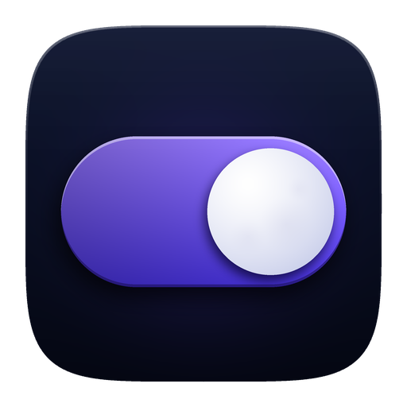
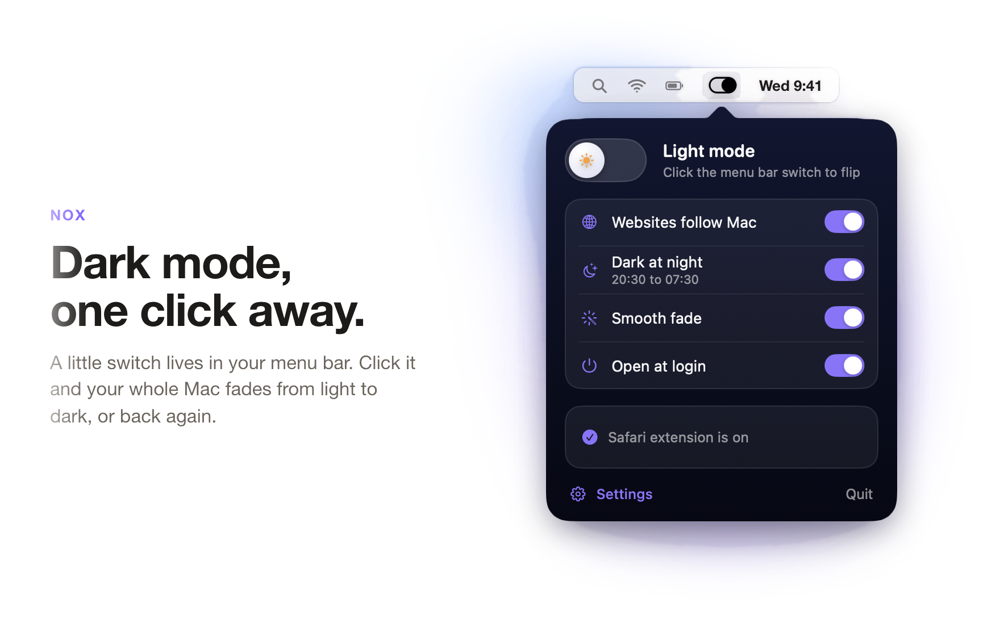
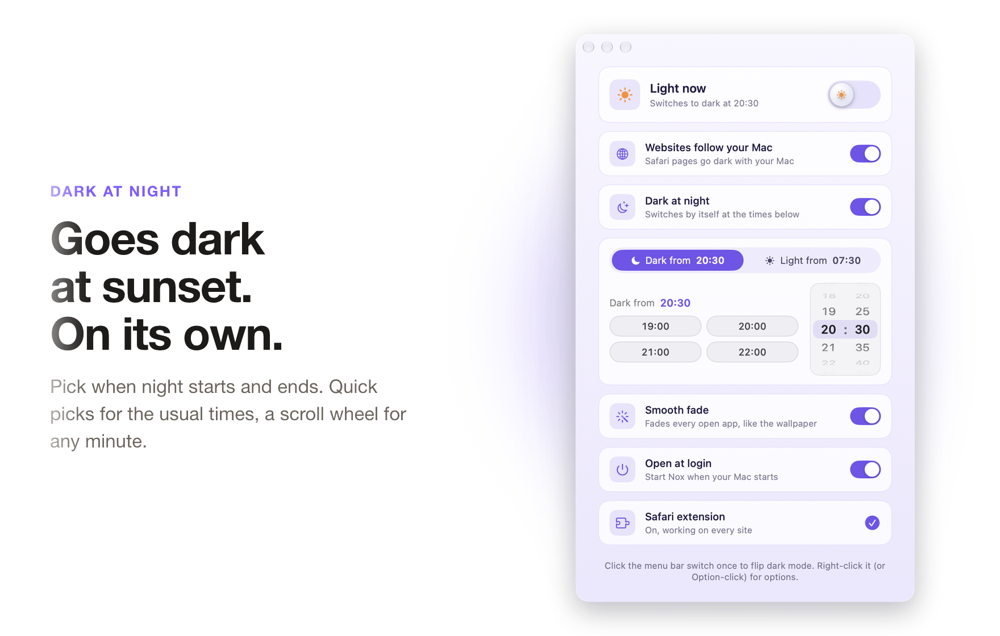
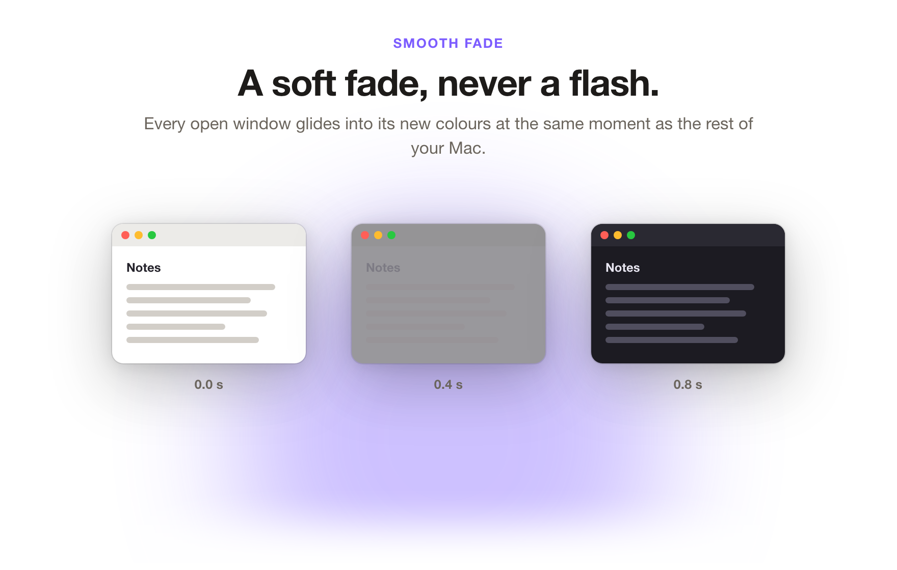

<div align="center">



<h1>Nox</h1>

<p><b>One click flips your Mac between light and dark. Websites go dark with it.</b></p>

<p>
  <a href="https://github.com/Solomon-69/Nox/releases/latest"></a>
  
  
  <a href="LICENSE"></a>
  
</p>

<p>
  <a href="https://github.com/Solomon-69/Nox/releases/latest"><b>Download</b></a>
  &nbsp;&middot;&nbsp;
  <a href="#install-on-mac">Install</a>
  &nbsp;&middot;&nbsp;
  <a href="#turn-on-the-safari-extension">Safari setup</a>
  &nbsp;&middot;&nbsp;
  <a href="PRIVACY.md">Privacy</a>
</p>

<br>

<picture>
  <source media="(prefers-color-scheme: dark)" srcset="docs/showcase/nox-1-dark.png">
  
</picture>

</div>

Nox is a small menu bar app. Click its switch and your whole Mac goes dark or light. When Nox's
switch is on, the Safari and Chrome extensions turn bright web pages dark too, so nothing
glares at you at night. Pages that already have a dark design are left alone.

## Contents

- [Features](#features)
- [Install on Mac](#install-on-mac)
- [Turn on the Safari extension](#turn-on-the-safari-extension)
- [Chrome extension](#chrome-extension)
- [Install on Windows](#install-on-windows)
- [Privacy](#privacy)
- [FAQ and troubleshooting](#faq-and-troubleshooting)
- [Build from source](#build-from-source)
- [Uninstall](#uninstall)
- [Contributing](#contributing)
- [Licence](#licence)

## Features

Nox makes dark mode a one-click thing, and takes the web along with it.

<picture>
  <source media="(prefers-color-scheme: dark)" srcset="docs/showcase/nox-2-dark.png">
  
</picture>

### Websites go dark with Nox's switch

macOS dark mode stops at the browser: most websites stay bright white. The Nox extension for Safari (and Chrome or Edge) fixes that. While Nox's switch is on, bright pages get a dark design. When Nox turns your Mac light again, pages go back to normal. Dark mode you turn on yourself in System Settings does not change web pages.

- Pages that already have their own dark design are left alone.
- Photos, videos and logos keep their real colours. Only the page itself changes.
- The extension only asks Nox whether its own switch is on. It never reads or sends what you browse.

<br>

<picture>
  <source media="(prefers-color-scheme: dark)" srcset="docs/showcase/nox-3-dark.png">
  
</picture>

### Goes dark at sunset, on its own

Turn on Dark at night and Nox switches your Mac to dark in the evening and back to light in the morning, even if you forget it is there.

- Defaults are 20:30 to 07:30. Change either time with a quick pick (19:00, 20:00, 21:00, 22:00) or the scroll wheel, to the minute.
- Opening Nox never changes your Mac's look by itself. It only switches when you click or when a scheduled time arrives.

<br>

<picture>
  <source media="(prefers-color-scheme: dark)" srcset="docs/showcase/nox-4-dark.png">
  
</picture>

### A soft fade, never a flash

Smooth fade makes the switch gentle on your eyes. Every open window glides into its new colours at the same moment as the rest of your Mac, like the wallpaper does.

- Optional: switch it off for an instant change.
- Respects the Reduce Motion setting on your Mac.


**Also:** open at login, an optional Dock icon, a right-click (or Option-click) panel and a Settings
window. Nox is small and native, with no account, no network access and no helper running in the
background. A Windows tray version and a Chrome and Edge extension follow the same ideas.


## Install on Mac

1. Download **Nox.dmg** (or the zip) from the [latest release](https://github.com/Solomon-69/Nox/releases/latest).
2. Open it and drag **Nox** into **Applications**.
3. Open Nox from Applications. A small switch appears in your menu bar.
4. A welcome window walks you through the permissions. Click each button and press **Allow** on Apple's prompts:
   - **Switch dark mode** lets Nox change light and dark (macOS calls this Automation for System Events).
   - **Dark websites in Safari** opens Safari's extension settings (see below).
   - A tip: Nox works best when most apps use Auto/System appearance.

**First launch on a build that is not notarised.** If a release is not notarised by Apple,
macOS asks before opening it the first time:

- Right-click Nox in Applications and choose **Open**, then click **Open** again.
- If the dialog only offers "Done", open **System Settings > Privacy & Security**, scroll down and click **Open Anyway** next to Nox.

You only do this once. Releases that are signed with a Developer ID and notarised open straight away.

Nox needs macOS 13 (Ventura) or later.

## Turn on the Safari extension

The Safari extension is inside the app, so there is nothing else to download. The
**Turn on** button in Nox's welcome window and Settings opens the right place in Safari.

If your copy of Nox is **not** signed with a Developer ID (a build you made yourself, or a
release that is not notarised), Safari treats the extension as unsigned. Do these steps in order:

1. Open Safari and choose **Safari > Settings > Advanced**. Tick **Show features for web developers**.
2. A **Developer** menu appears in the menu bar. Choose **Developer > Allow unsigned extensions** (Safari asks for your Mac password).
3. Go to **Safari > Settings > Extensions** and tick **Nox**. Click **Edit Websites** and set **When visiting other websites** to **Allow**, so it works on every site.

Safari forgets "Allow unsigned extensions" each time it quits, so with an unsigned build you may
need to repeat step 2 after restarting Safari. **Developer ID signed and notarised builds skip
steps 1 and 2.** Just tick Nox under Settings > Extensions. Nox checks how it was signed and
shows you the matching steps.

## Chrome extension

The Chrome extension lives in the [`ChromeExtension`](ChromeExtension) folder (download the
source zip from the release, or clone the repository).

1. In Chrome, go to `chrome://extensions`.
2. Turn on **Developer mode** (top right).
3. Click **Load unpacked** and choose the `ChromeExtension` folder.

On a Mac it needs the Nox app running: pages are dark only while Nox's own switch is on, and stay
as they are when Nox is not running. Chrome's theme must follow the system (Chrome **Settings >
Appearance > Mode: Device**). Edge, Brave and Arc work the same way. On Windows the extension
follows the system setting, since there is no Nox host to ask.

## Install on Windows

1. Download **Nox-windows.zip** from the [latest release](https://github.com/Solomon-69/Nox/releases/latest) and unzip it.
2. Open **Nox.exe**. A switch icon appears in the tray (next to the clock). If you do not see it, click the small arrow to show hidden icons.
3. Click the icon to flip Windows between light and dark. Open its panel for the night schedule and the smooth fade.
4. For dark websites, use the panel's **Open extension folder** button, then load that folder in Chrome or Edge with **Load unpacked** (steps above).

Nox for Windows needs Windows 10 or 11 and the free [.NET 8 Desktop Runtime](https://dotnet.microsoft.com/download/dotnet/8.0). Windows may show a SmartScreen warning on the first run because the app is not code signed. Click **More info**, then **Run anyway**.

## Privacy

Nothing leaves your Mac. Nox, the Safari extension and the Chrome extension make no network
requests and have no analytics or accounts. Settings stay in macOS preferences. The full
detail, including what each permission is used for, is in [PRIVACY.md](PRIVACY.md).

## FAQ and troubleshooting

<details>
<summary><b>The websites stay bright.</b></summary>

Check that your Mac is in dark mode, that the Websites switch is on in the panel, and
that Nox is ticked in **Safari > Settings > Extensions** with **Edit Websites** set to **Allow**.
For an unsigned build, also check **Developer > Allow unsigned extensions** is ticked again
after restarting Safari.
</details>

<details>
<summary><b>Safari lists Nox twice.</b></summary>

Every build folder is registered with macOS, so old builds show up as extra extensions. Nox
tells macOS to forget other copies each time it starts. Quit and reopen Nox, or see
[Build from source](#build-from-source) for the manual steps.
</details>

<details>
<summary><b>Why does it ask for Automation?</b></summary>

Automation (System Events) is how Nox switches light and dark. That is the only permission it
asks for. It never needs Screen Recording: the smooth fade is done by macOS itself, and Nox never
sees your screen.
</details>

<details>
<summary><b>Some sites look wrong when forced dark.</b></summary>

Forcing a dark look on every page cannot be perfect. Sites with their own dark design are left
alone. If one looks odd, switch the Websites option off, and please open an issue with
the address so it can be improved.
</details>

<details>
<summary><b>Does it collect any data?</b></summary>

No. See [PRIVACY.md](PRIVACY.md).
</details>

## Build from source

You need Xcode (with its command line tools). The Xcode project is generated from `project.yml`
with [XcodeGen](https://github.com/yonaskolb/XcodeGen).

```sh
git clone https://github.com/Solomon-69/Nox.git
cd Nox
brew install xcodegen
xcodegen
xcodebuild -scheme DarkSwitch -configuration Release -derivedDataPath build/DerivedData build
open build/DerivedData/Build/Products/Release/DarkSwitch.app
```

The project and scheme are still called **DarkSwitch** (the original working name); the app is
named Nox. Builds are ad-hoc signed by default, so anyone can build without an Apple account.
To sign with your own certificate, create a `Local.xcconfig` next to `Signing.xcconfig` (it is
git-ignored) with your own `CODE_SIGN_IDENTITY` and `DEVELOPMENT_TEAM`.

**One copy only.** Install by copying the built app to Applications, then tell macOS to forget
the build folder copy (nothing is deleted):

```sh
ditto build/DerivedData/Build/Products/Release/DarkSwitch.app ~/Applications/Nox.app
LSREGISTER=/System/Library/Frameworks/CoreServices.framework/Frameworks/LaunchServices.framework/Support/lsregister
BUILT=build/DerivedData/Build/Products/Release/DarkSwitch.app
pluginkit -r "$BUILT/Contents/PlugIns/DarkSwitchExtension.appex"
"$LSREGISTER" -u "$BUILT/Contents/PlugIns/DarkSwitchExtension.appex"; "$LSREGISTER" -u "$BUILT"
```

`./make-release.sh` builds the app and writes `release/Nox.dmg`.

The Windows app is in [`windows`](windows) and builds with the .NET 8 SDK:

```sh
dotnet publish windows/Nox.csproj -c Release -r win-x64 --self-contained false -p:PublishSingleFile=true -o out/Nox
```

Releases are built by [`release.yml`](.github/workflows/release.yml) when a `v*` tag is pushed.
It attaches `Nox.dmg`, a Mac zip, a Windows zip and checksums to a GitHub Release. If the Apple
signing secrets are set in the repository, the Mac app is also signed with a Developer ID and
notarised. If they are not, those steps are skipped.

## Uninstall

1. Quit Nox from its panel (right-click the menu bar icon).
2. Drag **Nox** from Applications to the Bin. This also removes the Safari extension.
3. Remove the Chrome extension from `chrome://extensions` if you loaded it.
4. Optional: clear settings with `defaults delete com.solomon.DarkSwitch` and delete `~/Library/Logs/DarkSwitch.log`.

## Contributing

Issues and pull requests are welcome. See [CONTRIBUTING.md](CONTRIBUTING.md). Security problems
go through [SECURITY.md](SECURITY.md), not public issues.

## Licence

[MIT](LICENSE). Copyright (c) 2026 Solomon.
